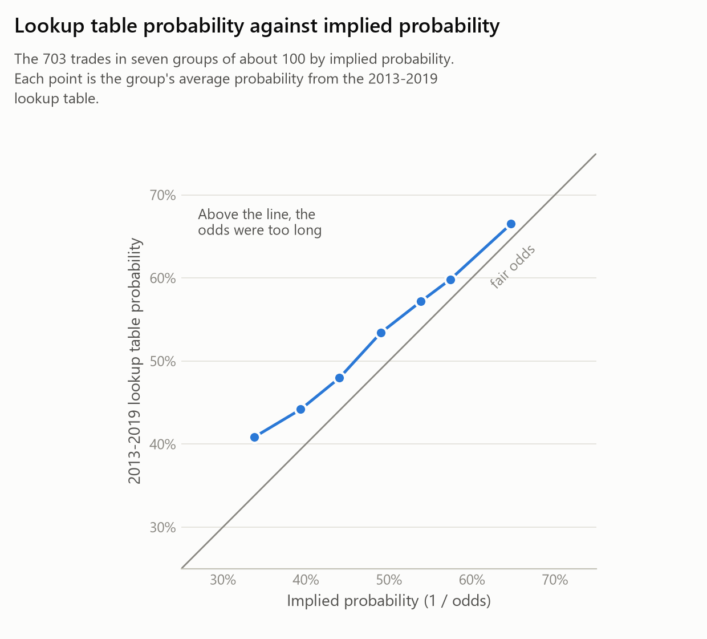
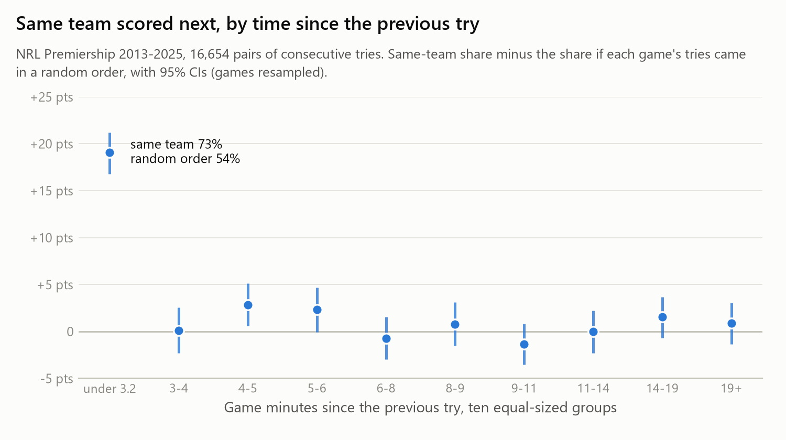
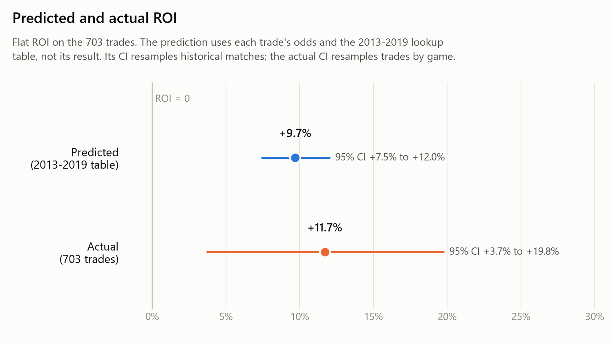
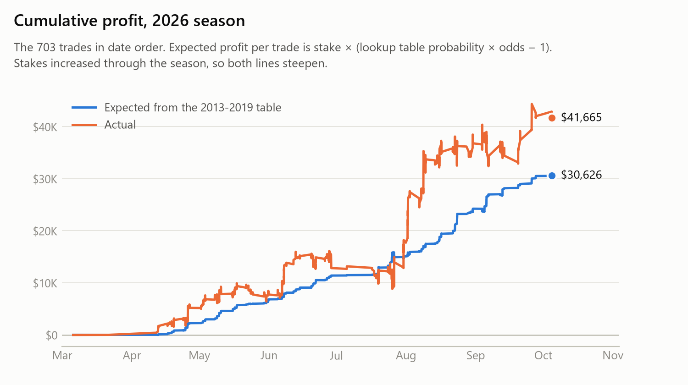
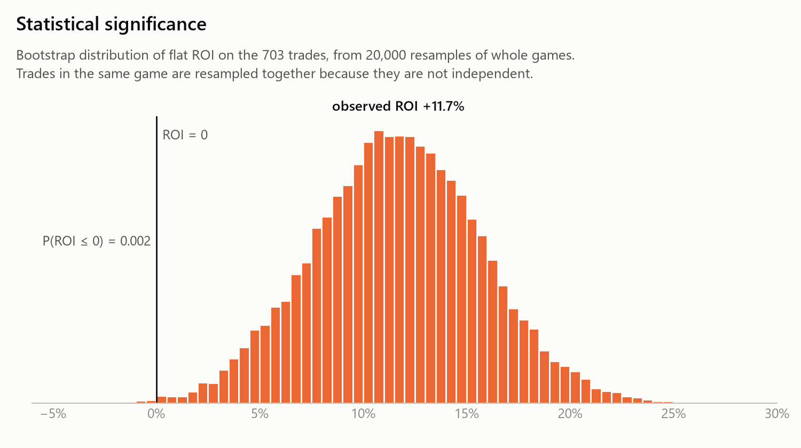
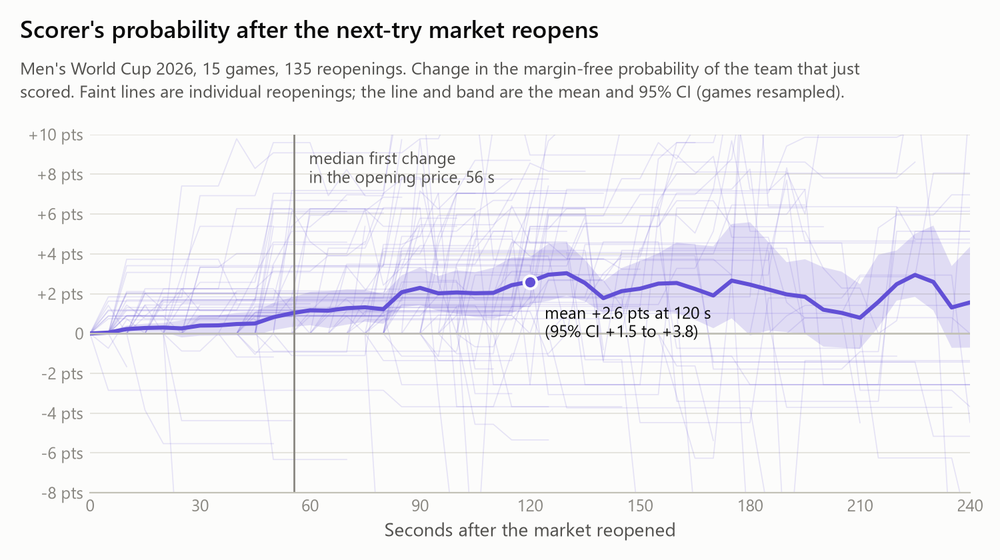
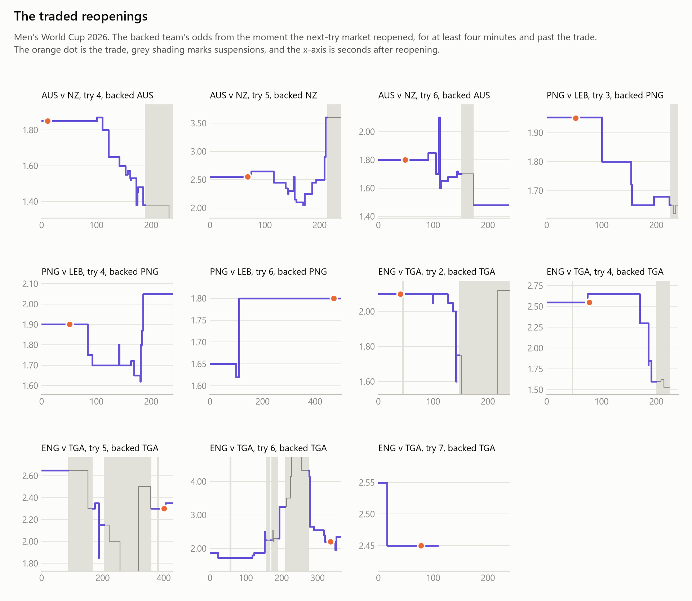
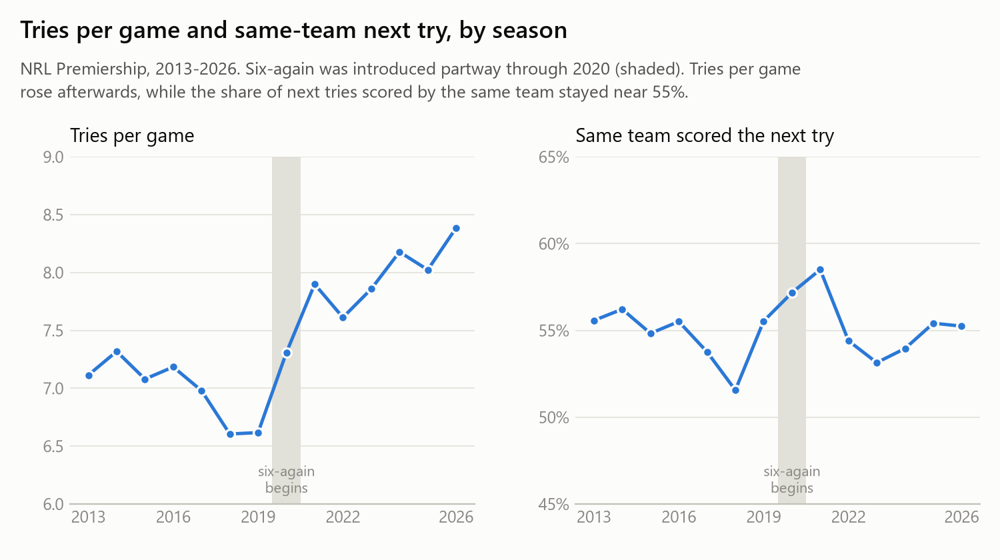

# Next-try pricing in the NRL

This repository tests whether a major online bookmaker's live "next try" odds undervalued the team that had just scored.

The strategy targets a market microstructure effect in the in-play next-try market. After each try, this bookmaker reopens its market about a minute before other bookmakers. In that window the price on the team that just scored is often long (for example 2.20 on a team priced at 1.90 to score the first try), and it converges back once the other bookmakers open their markets. The trades are placed in that window, before the rest of the market prices in.

Three pieces of evidence follow. NRL games from 2013 to 2019 say the price for the team that had just scored was too long, and applied to the odds actually taken they predict a flat ROI of +9.7%. A season of real trades returned +11.7%. And archived in-play prices from the 2026 World Cup show the opening price shortening over the two minutes after the market reopens.

**Summary**

| | |
|---|---|
| Trades | 703, NRL Premiership, 2026 season |
| Implied probability (1 / odds) | 48.2% |
| 2013-2019 lookup table probability | 52.2% |
| Predicted ROI from the lookup table | +9.7% (95% CI +7.5% to +12.0%) |
| Actual flat ROI | +11.7% (95% CI +3.7% to +19.8%) |
| CLV of the opening odds after two minutes, every World Cup reopening | +4.0% (95% CI +1.1% to +6.6%) |

**The market**

After each try the bookmaker offers odds on which team will score the next one. If no further try is scored, the bet is void. Every trade in the analysis was placed after at least one try had been scored.

**The edge in the historical data**

Every NRL game from 2013 to 2025 was collected from nrl.com, along with each game's pre-match odds. For each try in 2013-2019 that was followed by another try, the table below shows how often the same team scored the next one. The 8,403 moments are grouped by the scoring team's pre-match win probability (from the odds, with the margin removed) and its lead after the try. The pre-match probability only sorts the moments into groups. The probability of scoring next is counted from what actually happened.

| Pre-match win probability | Trailing or level | Leads by 1-6 | Leads by 7-12 | Leads by 13+ |
|---|---|---|---|---|
| Under 35% | 45% | 39% | 39% | 37% |
| 35-50% | 51% | 48% | 46% | 52% |
| 50-65% | 60% | 55% | 56% | 55% |
| 65-80% | 63% | 60% | 58% | 68% |
| Over 80% | 73% | 69% | 67% | 79% |

Each trade is assigned the probability p from its cell, or 1 - p if it backed the other team. Its expected return is p × odds - 1, and the mean over the 703 trades is the predicted ROI, +9.7%. The calculation uses each trade's odds but not its result. Rebuilding the table from 1,000 bootstrap resamples of the 2013-2019 matches gives a 95% CI of +7.5% to +12.0%, and no resample predicts an ROI at or below zero.



**Why the team that just scored**

After a try the conceding team kicks off, so the team that just scored gets the ball straight back. Splitting every pair of consecutive tries from 2013 to 2025 into ten equal-sized groups by the game time between them, the same team scored the next try 73% of the time in the quickest group (under about 3 minutes), against 54% if each game's tries came in a random order (a difference of +19.1 points, 95% CI +16.8 to +21.2). The quickest group was above random order in all 13 seasons, and in the other nine groups the difference is under 3 points. Of the 703 trades, 92% backed the team that had just scored, placed as the market reopened, just before that team received the kick-off. This explains why that team is more likely to score next, though not why the price was long, which the reopening section below covers. The grouping was chosen after looking at the data, so this result is exploratory.



**The live test**

The trades were placed through the 2026 season, starting with small stakes that grew as the results held up. Their results were never used in the prediction above, so they are an independent test of it.

| | |
|---|---|
| Implied probability | 48.2% |
| Win rate | 53.3% |
| Flat ROI | +11.7% |
| Stake-weighted ROI | +11.3% |

The figures above use the 703 core trades, the ones the 2013-2019 lookup table can be applied to. The historical data covers only the NRL Premiership, so the core trades exclude NRLW, State of Origin and World Cup games. Each was placed after at least one try had been scored, because the table is built around the team that had just scored, and void bets are left out because they have no result.

Across every trade in the file (783 in total, including NRLW, the World Cup, State of Origin and voids), the total staked was $420,175 for a profit of $47,902, a flat ROI of 11.6%. The core trades account for $41,665 of that profit, which is the figure in the cumulative profit chart below. The other $6,237 comes from the trades outside the core sample.





**Statistical significance**

Trades in the same game aren't independent, so the bootstrap resamples whole games, 20,000 times. The 95% CI for flat ROI is +3.7% to +19.8%, and P(ROI ≤ 0) = 0.002. Treating every trade on the same day as one cluster gives almost the same interval, +3.6% to +19.7%. The method was also checked on simulated trades with no edge, each winning with probability exactly 1 / odds. Across 1,000 simulated datasets, the 95% CI contained zero between 93% and 97% of the time, so the bootstrap isn't overconfident.



**The mechanism, price drift after the market reopens**

The trades target the moment the market reopens, so the opening price itself was tested. The MoviOdds historical odds API records the bookmaker's in-play prices with timestamps and suspension status, but its rugby league coverage starts on 13 October 2026, so this test uses the 2026 men's World Cup rather than the NRL. It covers every reopening of the next-try market in 15 games, 135 in all, traded or not. The measure is the margin-free probability of the team that had just scored, taken from both teams' prices at the same moment.

| Window after reopening | Change in the scorer's probability | 95% CI | Reopenings |
|---|---|---|---|
| 0 to 30 s | +0.4 pts | -0.1 to +0.9 | 125 |
| 0 to 60 s | +1.2 pts | +0.4 to +2.1 | 106 |
| 0 to 120 s | +2.6 pts | +1.5 to +3.8 | 67 |
| 180 to 240 s (control) | -0.2 pts | -3.2 to +1.9 | 24 |

If the reopening price were already efficient, the scorer's probability would be as likely to drift down as up after the market reopened. Instead the opening price held for a median of 56 seconds before its first change, then shortened, and over the later control window there was no drift. A consistent upward drift right after reopening means the opening price was often too long to back. In odds terms, taking the opening price beat the bookmaker's own price 60 seconds later by +1.9% on average (95% CI +0.7% to +3.4%), and 120 seconds later by +4.0% (95% CI +1.1% to +6.6%). At two minutes the opening price was better in 70% of reopenings and worse in 13%. The women's World Cup, analysed separately, shows the same pattern.



The traded reopenings follow the same path. Of the 7 with a clean two-minute window after the trade, shown below, every one got a better price than the market two minutes later, with a median CLV of +15.2%. The recorded prices also match the trades, with 10 of the 11 recorded fills at exactly the odds taken.



This part of the analysis has clear limits. The API only has this one bookmaker's prices, so it shows the opening price correcting but can't show the other bookmakers opening later. It covers 15 World Cup games, not the NRL, so it is evidence of the mechanism rather than a check of each NRL trade. It records price changes on its own schedule, so a gap can be missing data rather than an unchanged price. Windows cut short by a suspension or the next try are dropped, which is why the sample falls from 135 to 67 at two minutes. And the CLV is measured against the bookmaker's own later price, which includes its margin. With the margin removed, the opening odds are still about 2.6% below fair on average (95% CI -5.3% to -0.2%), so the correction on its own is about the size of the margin. The profit in the trades also depends on the price being long relative to the historical probabilities above.

**Testing the six-again hypothesis**

The original theory was that the 2020 "six again" rules were the reason, because a faster game should mean more runs of tries. It has been evident the NRL's interim CEO, Peter V'landys, is inclined to introduce a new 'kickoff' rule (letting the opposing team choose whether to receive or kickoff after a try is scored), [in an attempt to slow down 'momentum'](https://www.zerotackle.com/nrl-2026-rule-change-trial-what-is-it-when-is-it-being-used-why-is-it-happening-237429/). This rule was tested in a 'dead rubber' game towards the end of the 2026 NRL season. These actions only reinforce the curiosity that consecutive runs of momentum were happening more often, hence statistical tests were conducted. The test compares the real order of tries in each game with the same tries in a random order. Teams do score back-to-back more often than chance, but no more since the rule change than before.

| | 2013-2019 | 2021-2025 |
|---|---|---|
| Tries per game | 7.0 | 7.9 |
| Same team scored the next try | 54.8% | 55.1% |
| Excess over random order | +2.7% (95% CI +1.8% to +3.6%) | +2.2% (95% CI +1.2% to +3.2%) |

The excess is the share of consecutive tries scored by the same team beyond what each game's try counts would produce in a random order, so it isn't inflated by strong teams scoring more tries. A permutation test with 10,000 shuffles puts the 2021-2025 excess well above zero (p = 0.0001). The change after six-again is -0.5 points (95% CI -1.9 to +0.8). The rules did bring more tries per game, which meant more chances to bet, but the edge was already there before them.



**Caveats**

The odds are only known for trades that were actually placed, because there's no public record of live next-try odds. So this shows the odds were too long on these trades, not on every moment after a try. The lookup table only knows each team's pre-match strength and the score. It can't see what happens during a game, such as injuries, sin bins or which side is on top. The table's groups were set once, at round numbers, and not adjusted afterwards. It's one season of trades, and the implied probability includes the bookmaker's margin, so the bookmaker's own estimate was lower still. The strategy ended in late 2026 when the bookmaker restricted me from placing live in-play calls (in Australia, in-play bets have to be placed by phone), which caps its capacity.

**Data**

Match data comes from nrl.com's match centre, pre-match odds from [AusSportsBetting](https://www.aussportsbetting.com/data/), and World Cup in-play prices from the [MoviOdds historical odds API](https://moviodds.com/doc). None of these are included here. The odds file is free for personal use, and the match data is rebuilt by the scraper. data/trades.csv has every trade, with its time, competition, team, try number, odds, stake and result. Its match IDs number the games in the order they were traded.

**Repository layout**

| File | Purpose |
|---|---|
| data/trades.csv | Every trade |
| src/scrape.py | Downloads finished matches from nrl.com |
| src/nrl_microstructure/parse.py | Turns the saved matches into match and try tables |
| src/nrl_microstructure/odds.py | Pre-match win probabilities from historical odds |
| src/nrl_microstructure/join.py | Links each trade to its match and the tries either side of it |
| src/nrl_microstructure/evaluate.py | Flat and stake-weighted ROI and the bootstrap |
| src/nrl_microstructure/history.py | The 2013-2019 lookup table, the predicted ROI, same team next by time since the previous try, and the rule-change test |
| src/nrl_microstructure/clustering.py | The shuffle test for back-to-back tries, and the breakdown by time between tries |
| src/nrl_microstructure/reopening.py | In-play price dynamics after each reopening, and CLV |
| src/nrl_microstructure/figures.py | Draws the figures |
| tests/ | Tests for each step |

**How to run it**

The live test needs only data/trades.csv.

```
pip install -e ".[dev]"
python -m nrl_microstructure.evaluate
pytest
```

Rebuilding the historical data takes two to three hours, mostly to collect every game from nrl.com.

```
python src/scrape.py --seasons 2013-2026
python src/scrape.py --competition world-cup --seasons 2026
python src/scrape.py --competition womens-world-cup --seasons 2026
python -m nrl_microstructure.parse
python -m nrl_microstructure.odds path/to/nrl.xlsx
python -m nrl_microstructure.history
python -m nrl_microstructure.reopening
python -m nrl_microstructure.figures
```
